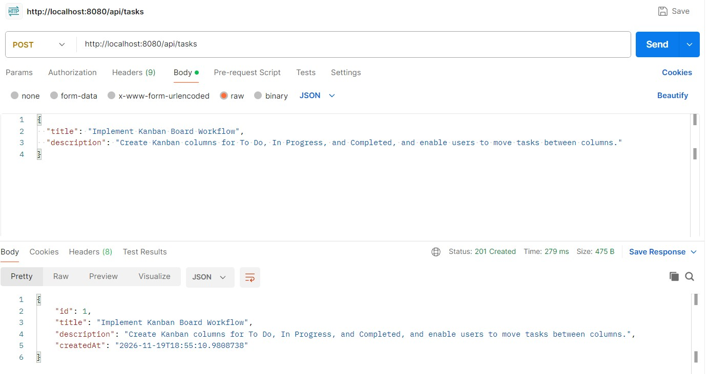
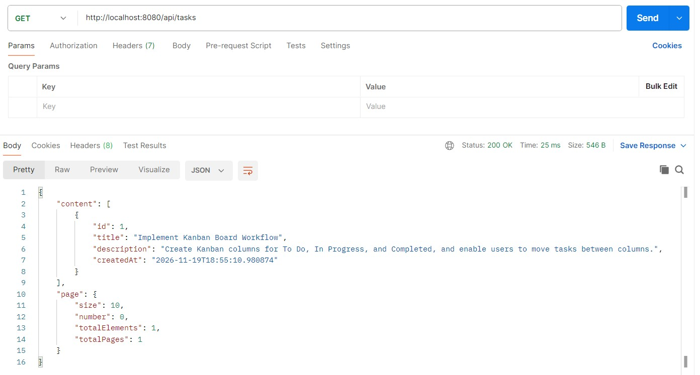
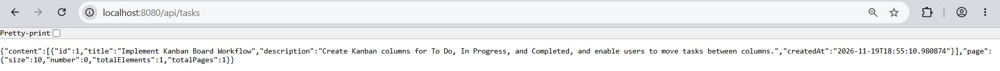
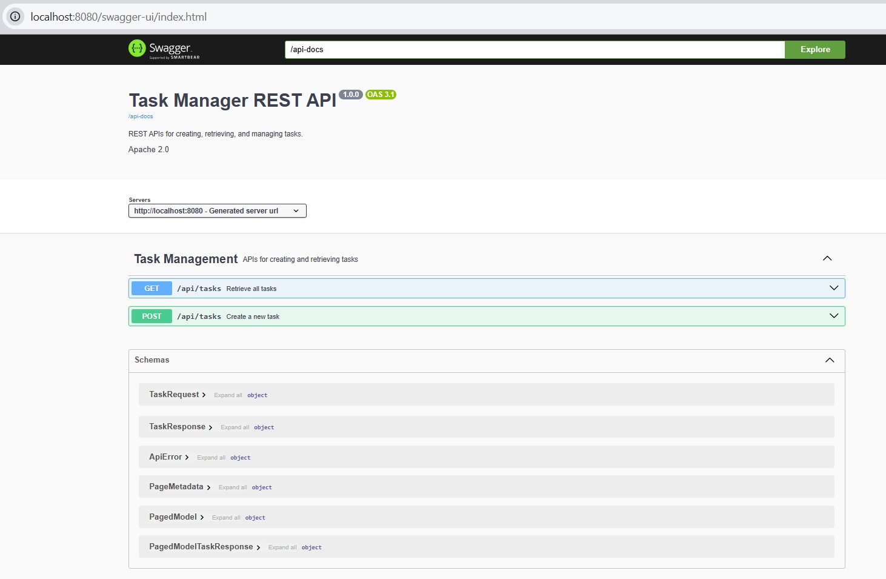
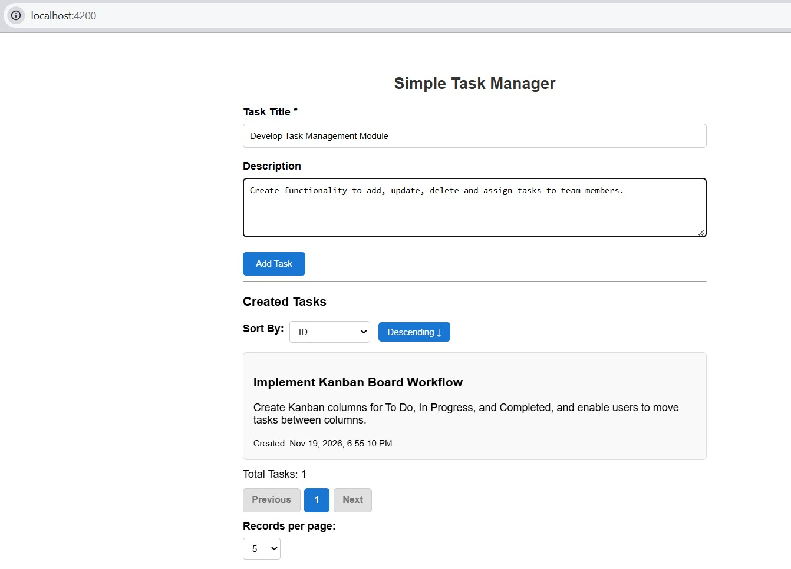
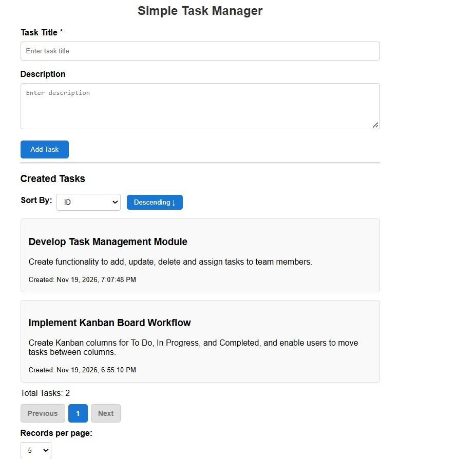

# Task Manager Application

A full-stack Task Manager application developed using Angular and Spring Boot.

## Technologies Used

### Frontend
- Angular
- Node v22.8.0
- TypeScript
- HTML5
- CSS3

### Backend
- Java version "17.0.8" 2023-07-18 LTS
- Spring Boot
- Spring Data JPA
- Hibernate
- Maven
- H2 Database

### IDEs
- IDE: Intellij IDEA Community Edition
- Visual Studio Code 1.137.0

## Project Structure

```text
taskmanager/
├── backend/     # Spring Boot application
├── frontend/      # Angular application
├── README.md
```

## Backend Setup

1. Navigate to the backend folder:

```bash
cd backend
```

2. Run the Spring Boot application:

```bash
mvn spring-boot:run
```

Backend URL: `http://localhost:8080`

## Frontend Setup

1. Navigate to the frontend folder:

```bash
cd frontend/task-manager-ui
```

2. Install dependencies:

```bash
npm install
```
3. Start Angular:

```bash
ng serve
```

Frontend URL: `http://localhost:4200`

## Working Features

- Angular frontend application.
- Spring Boot REST API.
- Backend and frontend integration.
- Task management functionality (as implemented).
- Database persistence using Spring Data JPA.
- Error Handling
- Swagger Implementation
- Pagination

## Pending Improvements

- Authentication and authorization.
- Improved exception handling.
- Unit and integration test coverage.
- User-friendly error messages.
- JWT-based authentication.
- Role-based access control.
- Logging and monitoring.

## Application Testing and Verification

### 1. Postman API Testing

Use Postman to verify the backend REST APIs.

**Create Task – POST**
- URL: `http://localhost:8080/api/tasks`
- Method: `POST`
- Header: `Content-Type: application/json`
- Request Body (JSON):

```json
{
  "title": "Implement Kanban Board workflow",
  "description": "Create a task for Kanban Board and add team members."
}
```

Expected Result:
- HTTP Status: `201 Created` (or the configured success status).
- Task should be saved successfully in the H2 database.
- Response should contain the generated task ID and task details.



### 2. Task List Verification

Verify the task listing functionality using the GET API.

- Confirm that all created tasks are displayed.
- Verify task ID, title, description, and creation timestamp.
- Verify pagination using page and size parameters.
- Verify sorting using supported sort fields and directions.
- Confirm that an empty task list is handled correctly.

**Get Tasks – GET**
- URL: `http://localhost:8080/api/tasks`
- Method: `GET`

Expected Result:
- HTTP Status: `200 OK`.
- Returns the list of created tasks.
- Pagination and sorting should work as expected.



### 3. API Browser Verification



### 4. Swagger UI

Swagger UI is available for exploring and testing the REST APIs directly through the browser.

- URL: `http://localhost:8080/swagger-ui/index.html`

Verification:
- Confirm that the Task API endpoints are listed.
- Execute the POST API to create a task.
- Execute the GET API to retrieve tasks.
- Verify request parameters, response status codes, and response data.



### 5. Task Manager UI Verification (Angular)

Start the Angular frontend application and access it through the browser.

- URL: `http://localhost:4200`

Verification:
- Confirm that the Task Manager UI loads successfully.
- Verify the task creation form.
- Confirm that the title field is mandatory.
- Verify that the description field is optional.
- Submit a new task and verify successful creation.
- Confirm that the newly created task appears in the task list.
- Verify pagination and sorting functionality.
- Verify appropriate error messages and exception handling.
- Confirm that frontend API integration with the Spring Boot backend works correctly.


- After clicking the 'Add Task' button, the newly created task is automatically displayed in the list below.



### 6. Overall Application Verification

| Component | Verification |
|---|---|
| Spring Boot Backend | REST API execution |
| Postman | POST and GET API testing |
| Task List | Data retrieval, pagination and sorting |
| Swagger UI | API documentation and browser testing |
| Angular Frontend | Task creation and task listing |
| H2 Database | Task persistence and retrieval |
| Exception Handling | Appropriate error responses |
## Author

Developed as a full-stack development project using Angular and Spring Boot.
